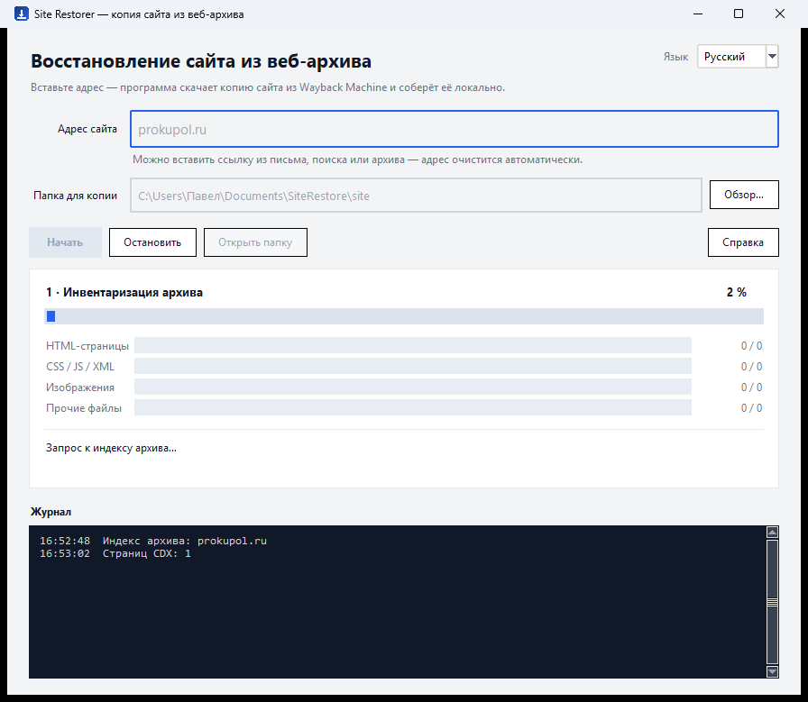

# Site Restorer

**Восстановление сайта из веб-архива в один клик.** Портативное приложение для Windows:
скачивает сохранённую копию сайта из Wayback Machine (Internet Archive), собирает её
для локального просмотра и показывает отчёт о полноте.

[](https://github.com/azxasd69/site-restorer/actions/workflows/build.yml)
[](https://github.com/azxasd69/site-restorer/releases)
[](LICENSE)


> English summary — at the bottom of this file.


---

## Зачем

Сайт умер, домен ещё резолвится, хостинг отвечает «нет сайта» — а контент нужен.
Веб-архив хранит копии, но вытащить их вручную больно: тысячи URL, лимиты,
переписанные ссылки, битые ассеты. Site Restorer делает это сам.

## Возможности

| Возможность | Детали |
|---|---|
| **Инвентаризация архива** | CDX-индекс: все сохранённые URL домена, постраничный обход для больших сайтов |
| **Параллельная загрузка** | HTML, CSS/JS, изображения и прочие файлы качаются одновременно |
| **Адаптивная конкурентность** | 2 → 24 потока по AIMD: разгон при росте скорости, срез при ошибках 429 |
| **Докачка** | уже скачанное не качается повторно, запуск продолжает с места остановки |
| **Работа с лимитами** | Retry-After, экспоненциальные паузы, «предохранитель» на серию 429, keep-alive |
| **Сборка оффлайн-копии** | ссылки → относительные, эвристики для кэша Bitrix и миниатюр |
| **Проверка** | подсчёт внутренних и битых ссылок, отчёт `report.html` |
| **Любой ввод адреса** | ссылка из письма, поиска, архива; русская раскладка; IDN-домены |
| **Любая CMS** | проверено на Bitrix, Craft CMS, Laravel, WordPress, MODX |
| **RU / EN** | переключение языка на лету |
| **Диагностика** | журнал с URL, HTTP-кодом, размером и временем каждого запроса |



## Установка

1. Скачайте `SiteRestorer.exe` (x64) или `SiteRestorer-x86.exe` (32-бит) со страницы
   [Releases](https://github.com/azxasd69/site-restorer/releases).
2. Положите в любую папку — установка не требуется.
3. Если Windows покажет SmartScreen («Windows защитила ваш компьютер») — «Подробнее» →
   «Выполнить всё равно», либо запустите `Unblock.cmd` из архива.

Требования: Windows 10 (1809+) или Windows 11, 64- или 32-бит. Python не нужен —
интерпретатор и Tcl/Tk встроены в exe.

## Использование

1. Введите адрес сайта — можно вставить что угодно: `prokupol.ru`,
   `https://www.prokupol.ru/catalog/?utm_source=x`, ссылку из архива или поиска.
   Адрес очистится автоматически.
2. Выберите папку (по умолчанию `Документы\SiteRestore\site`).
3. Нажмите **Начать**.

Результат:

```
<папка>
├── site\        готовая копия (открывать локальным веб-сервером)
├── mirror\      сырые файлы из архива
├── data\        inventory.jsonl — список адресов
└── report.html  отчёт о покрытии
```

Открыть копию:

```powershell
cd <папка>\site
python -m http.server 8080
# http://127.0.0.1:8080/
```

## Командная строка

```powershell
SiteRestorer.exe --cli --site prokupol.ru --out D:\mirror --workers 16 --limit 100
```

| Флаг | Значение |
|---|---|
| `--site` | адрес сайта |
| `--out` | папка результата |
| `--workers` | максимум потоков (по умолчанию 16) |
| `--rate` | глобальный лимит запросов/с (0 — без лимита) |
| `--limit` | ограничить число URL (для пробы) |
| `--lang` | `ru` или `en` |

## Как это работает

Подробно — в [ARCHITECTURE.md](ARCHITECTURE.md). Коротко:

1. **CDX-индекс** — узнаём, что архив вообще сохранил (постранично для больших доменов).
2. **Загрузка** — `id_`-режим Wayback отдаёт исходные байты без панели и переписанных ссылок;
   при 404 перебираются соседние годы.
3. **Сборка** — ссылки переписываются в относительные; для кэша CMS с хэшем в имени
   подставляется файл того же типа; миниатюры `resize_cache` заменяются оригиналом.
4. **Проверка** — обход HTML и подсчёт битых ссылок.
5. **Отчёт** — покрытие по типам, объёмы, ошибки.

## Ограничения

- Восстанавливается только то, что архив сохранил. Файлы, которые краулер не забирал
  (часто — картинки товаров), отсутствуют навсегда.
- Динамика CMS (корзина, вход, поиск, AJAX) в статической копии не работает.
- Архив ограничивает скорость с одного IP — большие сайты качаются часами, это нормально.
- Кэпы: 50 000 адресов и 200 страниц CDX; при их достижении копия будет неполной.

## Этика и право

Инструмент предназначен для личного архивирования и восстановления **своих** сайтов.
Он не обходит защиту, не подменяет User-Agent и не маскируется под браузер.
Пожалуйста, уважайте условия Internet Archive и авторские права владельцев контента:
копия чужого сайта — не основание для его публикации.

## Структура репозитория

```
site-restorer/
├── src/                 core.py, main.py, sanitize.py, app.ico
├── tests/               юнит-тесты (без сети)
├── docs/screenshots/    скриншоты для README
├── docs/prokupol-case.md
├── .github/workflows/   CI: тесты, сборка x64/x86, релиз по тегу
├── build.ps1            локальная сборка
├── publish.ps1          пуш и тег одной командой
├── ARCHITECTURE.md      как устроено внутри
├── CHANGELOG.md         история версий
├── CONTRIBUTING.md      как участвовать
├── SECURITY.md          как сообщить об уязвимости
└── LICENSE              MIT
```

## Тесты

```powershell
python -m unittest discover -s tests -v
```

Проверяются разбор адреса (14 случаев, включая русскую раскладку и IDN) и
построение путей (детерминизм, лимит длины, запрещённые имена Windows).
Тесты не обращаются к сети и выполняются за доли секунды.

## Участие

- [CONTRIBUTING.md](CONTRIBUTING.md) — окружение, правила кода, коммиты, PR.
- [CODE_OF_CONDUCT.md](CODE_OF_CONDUCT.md) — кодекс поведения.
- [SECURITY.md](SECURITY.md) — как приватно сообщить об уязвимости.
- Баги и идеи — через [issues](https://github.com/azxasd69/site-restorer/issues)
  (есть шаблоны).

## Сборка из исходников

```powershell
git clone https://github.com/azxasd69/site-restorer.git
cd site-restorer
py -3.14 -m venv .venv
.venv\Scripts\pip install pyinstaller==6.22.3
.\build.ps1            # соберёт dist\SiteRestorer.exe
.\build.ps1 -Arch x86  # 32-битная сборка (нужен 32-битный Python)
```

CI собирает обе архитектуры на тег `v*` и прикладывает exe к релизу —
см. [.github/workflows/build.yml](.github/workflows/build.yml).

## Благодарности

- [Internet Archive](https://archive.org/) — за сам архив и CDX API.
- [PyInstaller](https://pyinstaller.org/) — за возможность отдать один exe без зависимостей.
- Всем, кто присылает отчёты о нестандартных сайтах: именно так появились
  эвристики для Bitrix, MODX и WordPress.

## Лицензия

[MIT](LICENSE).

---

## English summary

**Site Restorer** is a portable Windows app that rebuilds a website from the
Internet Archive: it inventories the domain via the CDX API, downloads every
archived file in parallel with adaptive concurrency (AIMD, 2–24 threads),
politely handles rate limits (Retry-After, backoff, circuit breaker), rewrites
links into a browsable offline copy, checks for broken references and writes a
coverage report.

- Windows 10/11, x64 or x86, no installer and no Python required.
- Handles any address format (archive links, search redirects, wrong keyboard layout, IDN).
- Works with any CMS (tested on Bitrix, Craft CMS, Laravel, WordPress, MODX).
- RU/EN UI.

```powershell
SiteRestorer.exe --cli --site example.com --out D:\mirror --workers 16
```

Only what the archive actually saved can be recovered; dynamic CMS features
(cart, login, AJAX) do not work in a static copy. Use it for your own sites and
respect the Internet Archive terms and copyright law.
