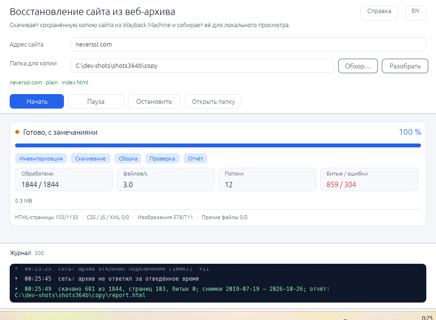
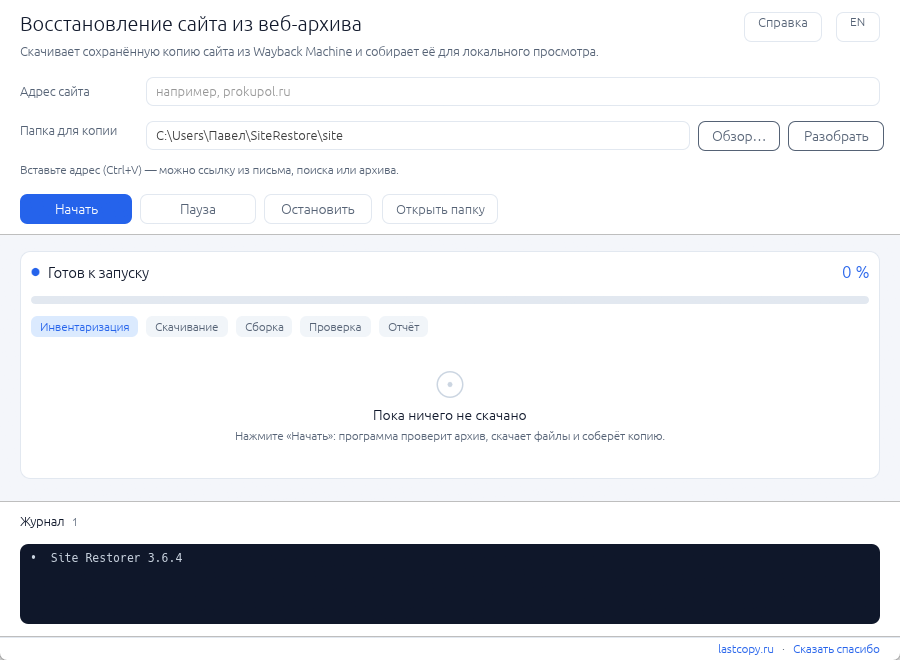
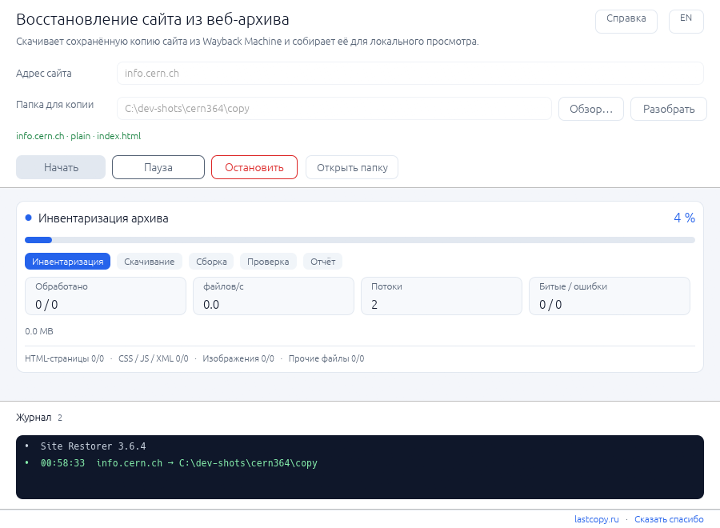
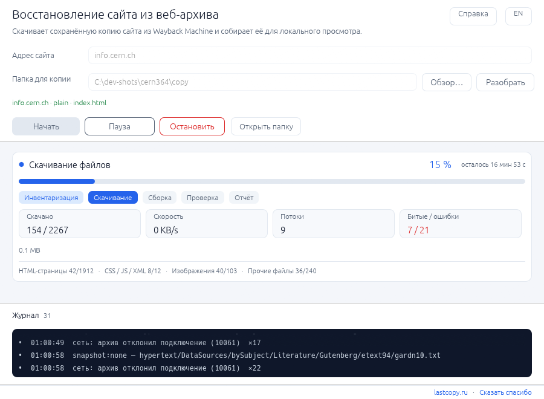

# Site Restorer

**Восстановление сайта из веб-архива в один клик.** Портативное приложение на Rust: инвентаризирует сохранённые страницы и ресурсы в Wayback Machine (Internet Archive), параллельно скачивает их, собирает рабочую статическую копию, открывает её встроенным локальным сервером и формирует подробный отчёт о полноте.

[](https://github.com/azxasd69/site-restorer/actions/workflows/build.yml) [](https://github.com/azxasd69/site-restorer/releases/latest) [](https://github.com/azxasd69/site-restorer/releases) [](LICENSE)

Сайт: **[lastcopy.ru](https://lastcopy.ru/)** · English site: **[lastcopy.ru/en](https://lastcopy.ru/en/)** · [English README summary](#english-summary)

> Реализация — **Rust** (единый исходник для нативного окна на `egui` и консольной сборки CLI). Прежние реализации на Python ([legacy/python](legacy/python)) и Go ([ports/go](ports/go)) переведены в архив: они больше не развиваются и не публикуются.

[Скачать](#скачать) · [Быстрый старт](#быстрый-старт) · [Возможности](#возможности) · [Командная строка](#командная-строка) · [Как это работает](#как-это-работает) · [Сборка и тесты](#сборка-и-тесты)



<details>
<summary>Ещё скриншоты интерфейса (стартовый экран, инвентаризация, загрузка)</summary>

| Стартовый экран | Инвентаризация архива | Загрузка файлов |
|---|---|---|
|  |  |  |

</details>

---

## Скачать

Актуальная версия — **[v3.6.6](https://github.com/azxasd69/site-restorer/releases/latest)** (15.11.2026). Постоянные ссылки `releases/latest/download/<имя>` всегда ведут на последний выпуск; полная матрица и требования к платформам описаны в [BUILD.md](BUILD.md) и [docs/PLATFORMS.md](docs/PLATFORMS.md).

| Файл | Платформа | Размер | Назначение |
|---|---|---|---|
| [`SiteRestorer-windows-x64.exe`](https://github.com/azxasd69/site-restorer/releases/latest/download/SiteRestorer-windows-x64.exe) | Windows 10/11 x64 | 9,0 МБ | **основной вариант**: окно `egui` + встроенный CLI |
| [`SiteRestorer-windows-x64-cli.exe`](https://github.com/azxasd69/site-restorer/releases/latest/download/SiteRestorer-windows-x64-cli.exe) | Windows x64 | 4,1 МБ | только командная строка (для скриптов и серверов) |
| [`SiteRestorer-linux-x64-gui`](https://github.com/azxasd69/site-restorer/releases/latest/download/SiteRestorer-linux-x64-gui) | Linux x64 | 27,8 МБ | нативное окно (нужны `libxkbcommon-x11-0`, `libgl1`, `libegl1`) |
| [`SiteRestorer-linux-x64-cli`](https://github.com/azxasd69/site-restorer/releases/latest/download/SiteRestorer-linux-x64-cli) | Linux x64 | 12,8 МБ | статический ELF (`musl`, без внешних библиотек) |
| [`SiteRestorer-linux-x64.tar.gz`](https://github.com/azxasd69/site-restorer/releases/latest/download/SiteRestorer-linux-x64.tar.gz) | Linux x64 | 12,7 МБ | оба Linux-бинарника + `install.sh`, `.desktop`, иконка |

К каждому релизу также прикладываются [`SHA256SUMS.txt`](https://github.com/azxasd69/site-restorer/releases/latest/download/SHA256SUMS.txt) и перечень зависимостей [`SBOM-site-restorer.cdx.json`](https://github.com/azxasd69/site-restorer/releases/latest/download/SBOM-site-restorer.cdx.json). Последняя 32-битная сборка для x86 — в архивном релизе [`v3.6.0`](https://github.com/azxasd69/site-restorer/releases/tag/v3.6.0) (причина прекращения описана в [docs/PLATFORMS.md](docs/PLATFORMS.md)).

- **Установка не требуется:** распакуйте или запустите `.exe` напрямую. Если Windows SmartScreen покажет предупреждение («Windows защитила ваш компьютер»), нажмите «Подробнее» → «Выполнить всё равно».
- **Linux (`tar.gz`):**

```bash
tar -xzf SiteRestorer-linux-x64.tar.gz
cd site-restorer-linux-x64
./install.sh                  # в ~/.local/bin (или PREFIX=/usr/local sudo ./install.sh)
site-restorer-gui             # графическое окно (без OpenGL 2.0+ используйте CLI)
```

---

## Быстрый старт

### Графический режим

1. Запустите `SiteRestorer-windows-x64.exe` (`site-restorer-gui`). Поле адреса уже в фокусе — нажмите `Ctrl+V`: можно вставить домен, ссылку из поиска, письма или самого `web.archive.org`, адрес очистится автоматически (включая русскую раскладку и IDN/Punycode).
2. При необходимости выберите папку результата (по умолчанию `%USERPROFILE%\SiteRestore\site` в Windows и `~/SiteRestore/site` в Linux).
3. Нажмите **Начать** (или `Enter`).
4. После сборки нажмите **Открыть копию** — программа поднимет встроенный локальный HTTP-сервер на `127.0.0.1` и откроет сайт в браузере. Сторонний софт и Python не требуются.

### Командная строка

```powershell
# Восстановить сайт (включая поддомен со статикой при необходимости)
SiteRestorer-windows-x64-cli.exe --cli --site example.com --out D:\copy --workers 8 --include-host cdn.example.com

# Открыть собранную копию встроенным сервером
SiteRestorer-windows-x64-cli.exe --serve D:\copy --port 8080
```

### Что появляется в папке результата

```text
<папка>/
├── site/        готовая оффлайн-копия (открывается кнопкой «Открыть копию» или --serve)
├── mirror/      сырые файлы из архива (база для повторного запуска и пересборки)
├── data/        inventory.jsonl   — инвентарь адресов и метаданные
│                build.jsonl       — инкрементальный журнал сборки
│                content-types.tsv — карта Content-Type ответов
│                snapshots.tsv     — даты снимков (переживают обновление версии)
│                no-snapshot.tsv   — адреса без снимка (повтор через --retry-missing дней)
└── report.html  подробный отчёт о покрытии, распаковке, подменах и битых ссылках
```

---

## Возможности

| Направление | Что делает программа |
|---|---|
| **Полнота CDX-индекса** | Пробует `showNumPages`, при `numpages > 1` обходит страницы параллельно в `2` потока (до `5` попыток, автооткат к `1` потоку при `503`/`429` и переход `domain → prefix` на `504`), не обрывает остаток при отказе одной страницы |
| **Оптимизированная загрузка** | Постоянный пул `keep-alive` (`64` общих / `32` на хост, `60 с`), дренирование коротких ответов `!= 200`, адаптивный `AIMD` (`2 с`) с учётом `429`, `5xx`, таймаутов и роста задержки без ложных спадов на мелких файлах |
| **Умный добор и докачка** | Перебор соседних лет (`--fallback-depth`), фоновый добор свежих URL (`recheck`), параллельный добор по отсутствующим ссылкам (`rescue`, до `4` потоков с приоритетом `CSS/JS → изображения → остальное`), продолжение прерванного прогона без перекачки готового и автоматическая уборка `.part` |
| **Сборка рабочей копии** | Сегментный разбор HTML (не портит `<script>`, `<style>`, `<!--...-->`), переписывание ссылок и `srcset`/`url(...)`, связывание поддоменов (`*.<host>` и `--include-host`), склейка минификаторов `?f=a.css,b.css` в `_min/`, перевод отсутствующих `/...` на живой адрес `https://<host>...` |
| **Автораспаковка и защита типов** | Побитовая распаковка `gzip` (`1f 8b`) в `.css`/`.js`/`.svg`/`.html` даже без заголовка `Content-Encoding`; отсев HTML-заглушек, отданных под видом иконок/шрифтов/стилей |
| **Кодировки** | Цепочка `BOM → UTF-8 → Content-Type / <meta> / XML / @charset → статистика`, починка двойного кодирования и смешанных `windows-1251 + UTF-8` вкраплений; результат всегда в UTF-8 |
| **Встроенный сервер (`--serve`)** | Локальный HTTP/1.1 сервер на `127.0.0.1` без зависимостей: `GET`/`HEAD`, точный маппинг `?query`, `Range` (`206`/`416`), `ETag`/`304`, защита от `..` и `%2e%2e` |
| **Честный отчёт и JSON** | `report.html` с карточкой `--serve`, разбивкой по типам, датами снимков, предупреждением при отсутствии CSS и строкой `RESULT {…}` для автоматизации |
| **Интерфейс RU / EN** | Нативное окно без зависимостей от браузера и Python, живой журнал с подсчётом повторов (`×N`), переключение языка на лету, запоминание настроек в профиле |

---

## Командная строка

Для работы в консоли используйте `SiteRestorer-windows-x64-cli.exe` (или оконный `.exe` с флагом `--cli` / `--serve` — он автоматически подключится к консоли).

```text
site-restorer --cli --site <адрес> [параметры]
site-restorer --serve <папка> [--port N]
site-restorer --version [--verbose]
```

| Флаг | По умолчанию | Описание |
|---|---|---|
| `--cli` | — | Запуск в консольном режиме без графического окна |
| `--site <адрес>` | обязателен в `--cli` | Домен, URL, ссылка из поиска/архива, IDN или ошибочная раскладка |
| `--out <папка>` | `SiteRestore/site` | Корневой каталог результата (`site/`, `mirror/`, `data/`, `report.html`) |
| `--workers <1..64>` | `16` | Потолок потоков скачивания (`Gate` регулируется в `1..=min(workers, 24)`) |
| `--threads <0..256>` | `0` (по ядрам, до `32`) | Число потоков для локальной сборки и проверки ссылок |
| `--rate <число>` | `0` | Максимум запросов в секунду суммарно по всем воркерам (`0` — без предела) |
| `--limit <N>` | `0` | Стратифицированная проба на `N` адресов (`0` — весь индекс) |
| `--include-host <домен>` | — | Включить поддомен или дополнительный хост (можно указывать несколько раз) |
| `--index-max-pages <N>` | `200` | Предел страниц индекса CDX (`0` — без ограничения) |
| `--snapshot <режим>` | `newest` | Стратегия выбора снимка: `newest`, `oldest` или дата (`ГГГГ[-ММ[-ДД]]`) |
| `--as-of <дата>` | — | То же, что `--snapshot <дата>` (`ГГГГ[-ММ[-ДД]]`) |
| `--since <дата>` | — | Нижняя граница даты для HTML-страниц (`ГГГГ` или `ГГГГ-ММ`; ассеты — из всей истории) |
| `--fallback-depth <N>` | `5` | Сколько более старых снимков пробовать при `404`/заглушке (`0` — выключить) |
| `--refresh-days <0..3650>` | `30` | Через сколько дней с последней проверки перекачивать уже сохранённый файл |
| `--refresh` | выкл | Проверить свежесть всех файлов заново (`TTL = 0`) |
| `--rescue-limit <N>` | `500` | Сколько отсутствующих целей догружать по ссылкам после сборки (`0` — выключить) |
| `--rescue-budget <сек>` | `30` | Лимит времени на этап добора по ссылкам (`0` — без ограничения) |
| `--retry-missing <0..3650>` | `7` | Через сколько дней повторять адреса, для которых не нашлось пригодного снимка |
| `--stub-bytes <N>` | `256` | Порог «пустой страницы» в байтах (короче — пробуется более старый снимок) |
| `--text-limit <байт>` | `4194304` (4 МБ) | Предел размера файла для переписывания ссылок (`0` — без предела) |
| `--serve <папка>` | — | Запустить встроенный локальный HTTP-сервер (`--serve --out <папка>` тоже поддерживается) |
| `--port <0..65535>` | `0` | Порт для `--serve` (`0` — случайный свободный порт на `127.0.0.1`) |
| `--lang <ru\|en>` | `ru` | Язык интерфейса, отчёта, журнала и CLI-сообщений (можно также через `SR_LANG`) |
| `--verbose` / `-v` | — | С `--version` печатает поддерживаемые инструкции CPU (`avx2`, `sha-ni`, `popcnt`) |

Неизвестный флаг с `--` или запись `--flag=value` (вместо пробела) немедленно отклоняются с кодом возврата `2` без сетевых запросов.

### Машиночитаемый итог (`RESULT`)

По завершении `--cli` выводит строку вида `RESULT {…}` в JSON со следующими полями: `ok`, `total`, `files`, `mirror`, `unique`, `pages`, `foreign`, `refs`, `broken`, `fallbacks`, `collisions`, `rescued`, `shared`, `left`, `oldest`, `newest`, `site`, `index_total`, `index_pages`, `index_truncated`, `index_failed`, `added_live`, `added_build`, `report`, `archive`, `unreadable`, `archive_requests`.

---

## Как это работает

Подробное описание архитектуры — в [ARCHITECTURE.md](ARCHITECTURE.md), проектных решений — в [DESIGN.md](DESIGN.md), требований — в [TZ.md](TZ.md).

1. **Инвентаризация (`inventory`):** запрос `showNumPages=true` в CDX API; при одной странице — быстрый запрос с `collapse=urlkey`, при `numpages > 1` — постраничный обход `0..pages` (2 потока, до 5 попыток, автооткат на `prefix` при `504`). URL нормализуются, коллизии путей отсеиваются по самому свежему снимку.
2. **Параллельная загрузка (`download`):** задачи перемешиваются по типам (`html`, `code`, `img`, `other`), готовые непустые файлы в `mirror/` пропускаются, дубликаты по `digest` получают жёсткие ссылки. Воркеры работают через общий `keep-alive` пул и шлюз `Gate` под управлением `AIMD`; запись идёт через `.part` с автораспаковкой скрытого `gzip`, проверкой на HTML-подмену и периодическим сбросом метаданных.
3. **Сборка копии (`build_dirty`):** инкрементальная обработка по `data/build.jsonl` в пуле `rayon`; сегментный разбор HTML, переписывание URL, поддоменов и минификаторов `?f=`, перевод отсутствующих корневых ссылок на `https://<host>...`, приведение кодировок к UTF-8 ([docs/encodings.md](docs/encodings.md)).
4. **Добор и проверка (`rescue` + `verify`):** отсутствующие цели добираются в приоритете `CSS/JS → изображения → остальное` (до `4` потоков в пределах `--rescue-budget`), затронутые страницы пересобираются, затем выполняется подсчёт внутренних и битых ссылок.
5. **Отчёт (`report.html`):** сводка покрытия, статистика снимков, распаковки, подмен, предупреждения и команда для запуска `--serve`.

---

## Ограничения и этика

- Восстанавливается **только** то, что когда-либо сохранил Internet Archive. Файлы, не попавшие в краул (например, часть картинок каталога), отсутствуют во всех снимках.
- Динамика CMS (корзина, авторизация, личный кабинет, поиск по базе, серверные формы и AJAX) в статической копии не работает.
- Скорость скачивания больших сайтов зависит от лимитов Internet Archive с одного IP.
- По умолчанию установлен предел `200` страниц CDX (`--index-max-pages 0` снимает его) и переписывания текста `4 МБ` (`--text-limit`).
- **Этика и право:** инструмент предназначен для личного архивирования и восстановления **собственных** сайтов. Он не обходит защиту, не маскирует `User-Agent` под браузер и не отправляет пользовательские данные на сторонние серверы. Уважайте условия Internet Archive и авторские права владельцев сайтов.

---

## Структура репозитория

```text
site-restorer/
├── src/                 Исходники Rust (17 модулей):
│                        core.rs (движок), serve.rs (встроенный сервер), app.rs (egui),
│                        main.rs (CLI/точка входа), paths.rs, encoding.rs, sanitize.rs,
│                        puny.rs, settings.rs, crash.rs, isa.rs, pick.rs, clip.rs,
│                        clock.rs, links.rs, i18n.rs, tr.rs
├── scripts/             Вспомогательные скрипты (check-flags.py, check_downloads.py, make-icons.py)
├── tools/               Генерация SBOM (sbom.py)
├── packaging/           Иконки, манифест Windows, install.sh и .desktop для Linux
├── landing/             Лендинг проекта (RU/EN, Markdown-версии и гайды) для GitHub Pages
├── docs/                Документация по платформам, кодировкам, релизам, снимкам и скриншоты
├── plans/               Аналитические отчёты, ревью и отчёты о выпусках
├── .github/workflows/   CI: гейты, сборки Windows/Linux, MSRV, проверка ссылок и релиз
├── legacy/python/       Архив: исходная реализация на Python (не развивается)
├── ports/go/            Архив: порт на Go (не развивается)
├── TZ.md                Техническое задание
├── DESIGN.md            Техническое решение
├── ARCHITECTURE.md      Архитектура
├── PLAN.md              План развития и реестр решений
├── BUILD.md             Матрица сборок и размеров
├── CHANGELOG.md         История версий
└── LICENSE              Лицензия MIT
```

---

## Сборка и тесты

Версия тулчейна закреплена в `rust-toolchain.toml` (`1.99.1`, минимальная поддерживаемая версия Rust — `1.88`). На Windows используется MSVC + статический CRT (`+crt-static`, настроено в `.cargo/config.toml`).

```bash
# Сборка
cargo build --release                                   # GUI + CLI (нативное окно)
cargo build --release --no-default-features             # только CLI
cargo build --release --target x86_64-unknown-linux-musl --no-default-features  # статический Linux

# Локальные проверки качества (без сети; те же гейты в CI)
cargo fmt --all -- --check
cargo clippy --all-targets --all-features -- -D warnings
cargo clippy --all-targets --no-default-features -- -D warnings
cargo nextest run --all-features                        # 150 тестов (GUI + CLI)
cargo nextest run --no-default-features                 # 147 тестов (CLI)
python scripts/check-flags.py
cargo audit && cargo deny check && cargo machete && typos
```

Инструкция по установке системных зависимостей Linux GUI и проверкам манифеста/glibc — в [BUILD.md](BUILD.md) и [docs/RELEASE.md](docs/RELEASE.md).

## Участие и лицензия

- Сообщить о проблеме или предложить доработку: [GitHub Issues](https://github.com/azxasd69/site-restorer/issues).
- Правила оформления изменений: [CONTRIBUTING.md](CONTRIBUTING.md); политика уязвимостей: [SECURITY.md](SECURITY.md).
- Реестр известных и устранённых дефектов: [docs/DEFECTS.md](docs/DEFECTS.md).
- Лицензия: **MIT** ([LICENSE](LICENSE)).

---

## English summary

**Site Restorer** rebuilds a website from the Internet Archive (Wayback Machine). Written in **Rust** (`egui` desktop UI + CLI + built-in HTTP copy server in a single portable binary, MIT-licensed).

### Key capabilities (v3.6.6)

- **Archive inventory:** queries Wayback CDX API (`showNumPages`, parallel `2`-thread paging when `numpages > 1` with `503`/`429` backoff and `504 domain → prefix` fallback), normalises URLs and deduplicates collisions by newest snapshot.
- **Optimised multithreaded download:** persistent `keep-alive` connection pool (`64` total / `32` per host), short non-200 body draining, `AIMD` (`2s` window) driven by `429`/overload/latency signals without false drops on small files, streaming byte counters, `.part` atomic writes with automatic cleanup, and resumable runs.
- **Offline assembly & built-in server (`--serve`):** segment-aware HTML/CSS/JS rewriting, automatic `gzip` (`1f 8b`) decompression even without `Content-Encoding`, HTML-in-resource filtering, subdomain/CDN linking (`--include-host`), minifier bundle recovery (`?f=`), mixed `windows-1251 + UTF-8` repair, and a built-in read-only `127.0.0.1` HTTP/1.1 server (`Range`, `ETag`, traversal protection) accessible via **Open copy** in the GUI or `--serve <folder>`.

### Quick start

```bash
# Restore a website in CLI mode
site-restorer --cli --site example.com --out ./copy --workers 8

# Browse the restored copy with the built-in local server (no Python required)
site-restorer --serve ./copy --port 8080
```

Download prebuilt binaries for **Windows x64** (`9.0 MB` GUI / `4.1 MB` CLI) and **Linux x64** (`27.8 MB` GUI / `12.8 MB` static `musl` CLI / `12.7 MB` `.tar.gz`) with `SHA256SUMS.txt` from [GitHub Releases](https://github.com/azxasd69/site-restorer/releases). Only content actually captured by the Internet Archive can be recovered; dynamic backend features (cart, login, search) do not run in a static copy. Use it responsibly for your own websites.
