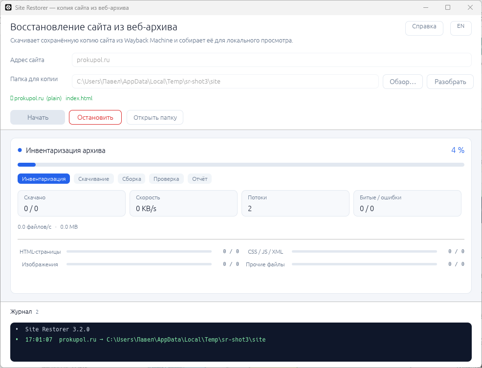
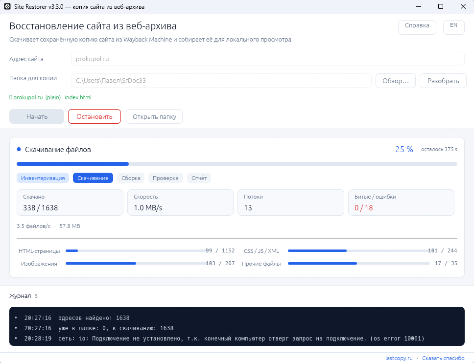
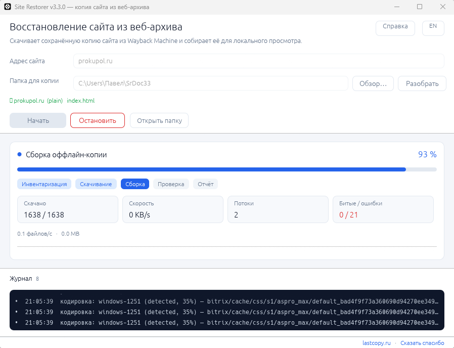

# Site Restorer

**Восстановление сайта из веб-архива в один клик.** Портативное приложение: скачивает
сохранённую копию сайта из Wayback Machine (Internet Archive), собирает её для
локального просмотра и показывает отчёт о полноте.

[](https://github.com/azxasd69/site-restorer/actions/workflows/build.yml) [](https://github.com/azxasd69/site-restorer/releases/latest) [](https://github.com/azxasd69/site-restorer/releases) [](LICENSE)

Сайт: **[lastcopy.ru](https://lastcopy.ru/)** · English: [lastcopy.ru/en](https://lastcopy.ru/en/)

Реализация — **Rust**: нативный интерфейс на egui и CLI в одном исходнике.
Python-версия (`legacy/python`) и порт на Go (`ports/go`) оставлены в репозитории
как история и **больше не разрабатываются и не публикуются**.


| Инвентаризация архива | Скачивание файлов |
|---|---|
|  |  |



## Скачать

Все сборки — на странице [Releases](https://github.com/azxasd69/site-restorer/releases);
ссылки `releases/latest/download/<имя>` всегда ведут на последнюю версию.
Полная матрица и команды сборки — в [BUILD.md](BUILD.md).

| Файл | Платформа | Размер |
|---|---|---|
| `SiteRestorer-windows-x64.exe` | Windows 10/11 x64 — **основной** | 6,2 МБ |
| `SiteRestorer-windows-x86.exe` | Windows 10/11 x86 | 5,6 МБ |
| `SiteRestorer-windows-x64-cli.exe` / `-x86-cli.exe` | Windows, только командная строка | 1,8 / 1,3 МБ |
| `SiteRestorer-linux-x64-gui` | Linux x64, нативное окно (X11/GL) | 7,5 МБ |
| `SiteRestorer-linux-x64-cli` | Linux x64, статический бинарник (musl) | 2,1 МБ |
| `SiteRestorer-linux-x64.tar.gz` | Linux x64: оба бинарника + `.desktop`, иконка, `install.sh` | 4,5 МБ |

Имена не содержат версию — ссылки `releases/latest/download/<имя>` постоянны.
Версию печатает `--version` и первая строка журнала.

Каждый релиз содержит `SHA256SUMS.txt` — контрольные суммы всех файлов.

Установка не требуется: распакуйте и запустите. Если Windows покажет SmartScreen
(«Windows защитила ваш компьютер») — «Подробнее» → «Выполнить всё равно».

Для Linux:

```bash
tar -xzf SiteRestorer-linux-x64.tar.gz
./site-restorer-linux-x64/install.sh          # в ~/.local, без root
site-restorer-gui                              # окно
site-restorer --cli --site example.com --out ~/SiteRestore/site
```

## Возможности

| Возможность | Детали |
|---|---|
| **Инвентаризация архива** | CDX-индекс: все сохранённые URL домена, постраничный обход для больших сайтов |
| **Параллельная загрузка** | HTML, CSS/JS, изображения и прочие файлы качаются одновременно |
| **Адаптивная конкурентность** | 2 → 24 потока по AIMD: разгон при росте скорости, срез при ошибках 429 |
| **Докачка** | уже скачанное не качается повторно, запуск продолжает с места остановки |
| **Работа с лимитами** | Retry-After, экспоненциальные паузы, «предохранитель» на серию 429 |
| **Сборка оффлайн-копии** | ссылки → относительные, кодировки → UTF-8, эвристики кэша CMS и миниатюр |
| **Проверка** | подсчёт внутренних и битых ссылок, отчёт `report.html` |
| **Любой ввод адреса** | ссылка из письма, поиска, архива; русская раскладка; IDN-домены |
| **RU / EN** | переключение языка на лету |
| **Диагностика** | журнал с URL, HTTP-кодом, размером и временем каждого запроса |

## Использование

1. Введите адрес — можно вставить что угодно: `example.com`,
   `https://www.example.com/catalog/?utm_source=x`, ссылку из архива или поиска.
   Адрес очистится автоматически.
2. Выберите папку. По умолчанию — `%USERPROFILE%\SiteRestore\site` (в Linux
   `~/SiteRestore/site`); в командной строке без параметра папки — `SiteRestore/site`
   от текущего каталога.
3. Нажмите **Начать** (или Enter в поле адреса).

Адрес, папка, язык и размер окна запоминаются: в Windows — `%APPDATA%\SiteRestorer\config.json`,
в Linux — `$XDG_CONFIG_HOME/site-restorer/config.json`. Сбросить значения — кнопка в окне
справки.

### Вставка адреса

Поле адреса получает фокус сразу при запуске — `Ctrl+V` работает без клика мышью.
Раскладка не важна: при русской раскладке Ctrl+V всё равно попадает в поле
(работает физическая клавиша V).

| Способ | Windows | Linux | macOS |
|---|---|---|---|
| `Ctrl+V` / `Cmd+V` | да | да | да |
| `Shift+Insert` | да | да | — |
| `Ctrl+Shift+V` | да | да | да |
| средняя кнопка мыши (PRIMARY) | — | да | — |

Что происходит после вставки: текст из буфера чистится (BOM, невидимые символы,
переводы строк, markdown `[текст](ссылка)`, кавычки, `<...>`), из него берётся
первый валидный адрес, поле заменяется чистым доменом, подсказка внизу показывает
разбор, а в журнал пишется строка `адрес: <было> → <стало>`. Если разобрать
ничего не удалось, поле не трогаем — только предупреждение.

Во время набора подсказка обновляется сама через 0,4 с после последней клавиши.
`Enter` — разобрать и запустить, `Esc` — снять фокус с поля, уход фокуса
(клик в другое место) — нормализовать поле до домена.

Результат:

```
<папка>
├── site\        готовая копия (открывать локальным веб-сервером)
├── mirror\      сырые файлы из архива
├── data\        inventory.jsonl — список адресов
└── report.html  отчёт о покрытии
```

Открыть копию:

```bash
cd <папка>/site
python -m http.server 8080
# http://127.0.0.1:8080/
```

## Командная строка

```
site-restorer --cli --site <адрес> --out <папка> [--limit N] [--workers N] [--threads N]
                [--snapshot newest|oldest|<дата>] [--as-of ГГГГ[-ММ[-ДД]]] [--since ГГГГ[-ММ]]
                [--refresh-days N] [--refresh] [--fallback-depth N] [--rescue-limit N]
site-restorer --version
```

| Флаг | Значение |
|---|---|
| `--site` | адрес сайта в любом виде |
| `--out` | папка результата |
| `--workers` | потолок параллельных загрузок (по умолчанию 16) |
| `--threads` | потоков сборки копии и проверки ссылок (0 — по числу ядер, не больше 32) |
| `--rate` | максимум запросов в секунду (0 — без ограничения) |
| `--snapshot` | что брать из архива: `newest` — самый свежий снимок (по умолчанию), `oldest` — самый ранний, как в 3.4.0, или дата `ГГГГ-ММ-ДД` |
| `--as-of` | снимок, ближайший к указанной дате; то же, что `--snapshot <дата>` |
| `--fallback-depth` | сколько более старых снимков пробовать, если свежий пуст или непригоден (5; 0 — выключить) |
| `--refresh-days` | через сколько дней с последней проверки файл перекачивается (30) |
| `--refresh` | проверить свежесть всех файлов заново |
| `--since` | окно для страниц: `ГГГГ` или `ГГГГ-ММ`; ресурсы (стили, картинки) берутся из полной истории |
| `--rescue-limit` | сколько отсутствующих целей догружать по ссылкам (500; 0 — выключить) |
| `--rescue-budget` | предел времени на добор по ссылкам, секунд (30; 0 — без предела) |
| `--retry-missing` | через сколько дней повторять адрес, у которого не было снимка (7; 0 — каждый раз) |
| `--stub-bytes` | порог «пустой страницы» в байтах: короче — берём более старый снимок (256) |
| `--limit` | ограничить число адресов (быстрая проба) |
| `--lang` | язык интерфейса и сообщений: `ru` / `en` |

Повторный прогон в ту же папку не пересобирает неизменённые файлы: рядом с копией лежит
журнал `data/build.jsonl`, и в журнал работы идёт строка «сборка: без изменений N, обновлено M».
Журнал помечен версией программы и хостом: после обновления или смены сайта копия собирается
заново. Файлы, исчезнувшие из зеркала, удаляются только при полном прогоне, без `--limit`.

По завершении печатается строка `RESULT {…}` — тот же итог в JSON, чтобы прогон разбирался
скриптом: `ok` (скачано адресов), `total` (адресов в инвентаре), `files` (файлов в копии),
`mirror` (файлов в зеркале), `unique` (уникальных путей), `pages`, `foreign` (файлов не того
типа), `refs`, `broken`, `site`, `report`. Адресов может быть больше, чем файлов: разные
адреса ведут на один файл.

## Как это работает

Подробно — в [ARCHITECTURE.md](ARCHITECTURE.md). Коротко:

1. **CDX-индекс** — узнаём, что архив сохранил (постранично для больших доменов). Адрес
   архива — `https://web.archive.org`, при закрытом 80-м или 443-м порте программа переходит
   на вторую схему и запоминает рабочую; отказ индекса повторяется до пяти раз с паузой
   от 5 до 80 секунд.
2. **Загрузка** — `id_`-режим Wayback отдаёт исходные байты без панели и переписанных ссылок;
   при 404 перебираются соседние годы.
3. **Сборка** — ссылки переписываются в относительные, кодировки приводятся к UTF-8,
   для кэша CMS с хэшем в имени подставляется файл того же типа, миниатюры заменяются оригиналом.
4. **Проверка** — обход HTML и подсчёт битых ссылок.
5. **Отчёт** — покрытие по типам, объёмы, ошибки.

## Ограничения

- Восстанавливается только то, что архив сохранил. Файлы, которые краулер не забирал
  (часто — картинки товаров), отсутствуют навсегда.
- Динамика CMS (корзина, вход, поиск, AJAX) в статической копии не работает.
- Архив ограничивает скорость с одного IP — большие сайты качаются часами.
- Кэпы: 50 000 адресов и 200 страниц CDX.

## Этика и право

Инструмент предназначен для личного архивирования и восстановления **своих** сайтов.
Он не обходит защиту, не подменяет User-Agent и не маскируется под браузер.
Уважайте условия Internet Archive и авторские права владельцев контента:
копия чужого сайта — не основание для его публикации.

## Структура репозитория

```
site-restorer/
├── src/                 Rust: main.rs, app.rs (egui), core.rs, paths.rs, sanitize.rs, i18n.rs
├── examples/            вспомогательные примеры (fetch.rs)
├── tests/               Rust-тесты (в src/*.rs, модули #[cfg(test)])
├── legacy/python/       архив: исходная реализация на Python (не развивается)
├── ports/go/            архив: порт на Go (не развивается)
├── landing/             лендинг проекта (RU/EN) для GitHub Pages
├── docs/                скриншоты, кейс, заметки по сборке под Windows
├── .github/workflows/   CI: тесты, сборки всех стеков, релиз по тегу
├── Cargo.toml           Rust-пакет (бинарь + фича gui)
├── BUILD.md             матрица сборок и размеров
├── ARCHITECTURE.md      как устроено внутри
├── TZ.md                техническое задание
├── DESIGN.md            техническое решение
├── PLAN.md              план доработок
├── CHANGELOG.md         история версий
└── LICENSE              MIT
```

## Тесты

```bash
cargo nextest run --release --no-default-features   # 50 тестов, без сети
cargo fmt --all --check
cargo clippy --all-targets --release --no-default-features -- -D warnings
cargo audit && cargo deny check && cargo machete && typos
```

Те же команды выполняет CI на каждый push и pull request.

## Сборка из исходников

Rust (версия тулчейна закреплена в `rust-toolchain.toml` — 1.99.1; для Windows — MSVC):

```bash
cargo build --release                                   # GUI + CLI, нативное окно
cargo build --release --no-default-features             # только CLI
cargo build --release --target x86_64-unknown-linux-musl --no-default-features   # статический Linux
```

Кросс-сборка под Windows x86: `rustup target add i686-pc-windows-msvc` и
`cargo build --release --target i686-pc-windows-msvc`.

Python-версия и порт на Go больше не собираются: их каталоги оставлены как
архив исходников, сборки из них в релиз не попадают.

## Участие

- [TZ.md](TZ.md) — техническое задание: требования и критерии приёмки.
- [DESIGN.md](DESIGN.md) — техническое решение; [PLAN.md](PLAN.md) — план доработок.
- [docs/DEFECTS.md](docs/DEFECTS.md) — реестр дефектов: что сломано, почему, в какой версии исправлено.
- [CONTRIBUTING.md](CONTRIBUTING.md) — окружение, правила кода, коммиты, PR.
- [SECURITY.md](SECURITY.md) — как приватно сообщить об уязвимости.
- Баги и идеи — через [issues](https://github.com/azxasd69/site-restorer/issues).

## Лицензия

MIT. Подробности — [LICENSE](LICENSE).

---

## English summary

**Site Restorer** rebuilds a website from the Internet Archive. It is written in
Rust (native egui window + CLI, 2–9 MB). The original Python/Tk version
(`legacy/python`) and the Go port (`ports/go`) are kept as history only — they
are no longer developed or published.

It inventories the domain via the CDX API, downloads every archived file in
parallel with adaptive concurrency (AIMD, 2–24 threads), politely handles rate
limits, rewrites links into a browsable offline copy, converts charsets to UTF-8,
checks for broken references and writes a coverage report.

```bash
site-restorer --cli --site example.com --out ./mirror
```

Windows 10/11 builds (x64 and x86) are published on the Releases page together
with Linux binaries and `SHA256SUMS.txt`. Only what the archive actually saved
can be recovered; dynamic CMS features do not work in a static copy. Use it for
your own sites and respect the Internet Archive terms and copyright law.

## Linux

В релизе есть `SiteRestorer-linux-x64.tar.gz`: консольная (`site-restorer`,
статическая musl) и оконная (`site-restorer-gui`) сборки, `install.sh`, `.desktop`
и иконка.

```bash
tar -xzf SiteRestorer-linux-x64.tar.gz
cd site-restorer-linux-x64
./install.sh          # в ~/.local, или PREFIX=/usr/local sudo ./install.sh
```

Окну нужны `libxkbcommon-x11-0`, `libgl1`, `libegl1`
(`sudo apt install libxkbcommon-x11-0 libgl1 libegl1`). Без OpenGL 2.0+ (ВМ, RDP)
окно покажет сообщение — используйте консольную версию.

## Кодировки

Копия всегда собирается в UTF-8. Кодировка исходной страницы определяется по
цепочке: BOM → валидный UTF-8 → `Content-Type` → `<meta charset>` →
`<?xml encoding?>` → `@charset` → статистика по содержимому (`chardetng`).
Объявление не считается приказом: если по нему текст нечитаем, а альтернатива
читается, выбирается альтернатива — заголовки веб-архива часто не совпадают
с телом. Если `<meta charset>` оказалась глубже первых 1024 байт (браузер
дальше не смотрит), сразу после `<head>` вставляется `<meta charset="utf-8">`.
Двоичные файлы под текстовым расширением (JPEG или PDF с адресом `.html`)
копируются без изменений. Подробный разбор и варианты решения —
[docs/encodings.md](docs/encodings.md).

