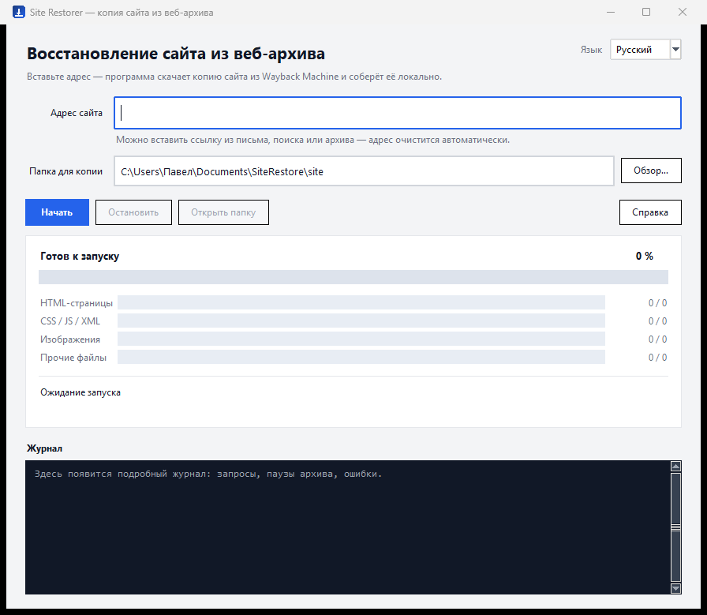

# Site Restorer

**Восстановление сайта из веб-архива в один клик.** Портативное приложение: скачивает
сохранённую копию сайта из Wayback Machine (Internet Archive), собирает её для
локального просмотра и показывает отчёт о полноте.

Основная реализация — **Rust** (нативный интерфейс на egui + CLI в одном бинарнике).
В репозитории также лежат: исходная версия на Python (`legacy/python`) и
экспериментальный порт на Go (`ports/go`).



## Скачать

Все сборки — на странице [Releases](https://github.com/azxasd69/site-restorer/releases);
ссылки `releases/latest/download/<имя>` всегда ведут на последнюю версию.
Полная матрица и команды сборки — в [BUILD.md](BUILD.md).

| Файл | Платформа | Размер |
|---|---|---|
| `SiteRestorer.exe` | Windows 10/11 x64 — **основной** | 6,2 МБ |
| `SiteRestorer-x86.exe` | Windows 10/11 x86 | 5,6 МБ |
| `SiteRestorer-rust-linux-cli` | Linux x64, статический бинарник | 2,1 МБ |
| `SiteRestorer-rust-linux-gui` | Linux x64, нативное окно (X11/GL) | 7,5 МБ |
| `SiteRestorer-rust-win-cli-x64.exe` / `-x86.exe` | Windows, только командная строка | 1,8 / 1,3 МБ |
| `SiteRestorer-python-win-x64.exe` | Windows x64, классическая версия на Python | 12,6 МБ |
| `SiteRestorer-python-win-x86.exe` | Windows x86, классическая версия | 10,2 МБ |
| `SiteRestorer-python-linux-x64` | Linux x64, классическая версия | 27 МБ |
| `siterestorer-go-*` | Linux x64/arm64, Windows x64/x86 | 7,9–8,3 МБ |

Каждый релиз содержит `SHA256SUMS.txt` — контрольные суммы всех файлов.

Установка не требуется: распакуйте и запустите. Если Windows покажет SmartScreen
(«Windows защитила ваш компьютер») — «Подробнее» → «Выполнить всё равно».

Для Linux:

```bash
chmod +x SiteRestorer-rust-linux-cli
./SiteRestorer-rust-linux-cli --cli --site example.com --out ~/SiteRestore/site
```

## Возможности

| Возможность | Детали |
|---|---|
| **Инвентаризация архива** | CDX-индекс: все сохранённые URL домена, постраничный обход для больших сайтов |
| **Параллельная загрузка** | HTML, CSS/JS, изображения и прочие файлы качаются одновременно |
| **Адаптивная конкурентность** | 2 → 24 потока по AIMD: разгон при росте скорости, срез при ошибках 429 |
| **Докачка** | уже скачанное не качается повторно, запуск продолжает с места остановки |
| **Работа с лимитами** | Retry-After, экспоненциальные паузы, «предохранитель» на серию 429 |
| **Сборка оффлайн-копии** | ссылки → относительные, кодировки → UTF-8, эвристики кэша CMS и миниатюр |
| **Проверка** | подсчёт внутренних и битых ссылок, отчёт `report.html` |
| **Любой ввод адреса** | ссылка из письма, поиска, архива; русская раскладка; IDN-домены |
| **RU / EN** | переключение языка на лету |
| **Диагностика** | журнал с URL, HTTP-кодом, размером и временем каждого запроса |

## Использование

1. Введите адрес — можно вставить что угодно: `example.com`,
   `https://www.example.com/catalog/?utm_source=x`, ссылку из архива или поиска.
   Адрес очистится автоматически.
2. Выберите папку (по умолчанию `Документы\SiteRestore\site`).
3. Нажмите **Начать** (или Enter в поле адреса).

### Вставка адреса

Поле адреса получает фокус сразу при запуске — `Ctrl+V` работает без клика мышью.
Раскладка не важна: при русской раскладке Ctrl+V всё равно попадает в поле
(работает физическая клавиша V).

| Способ | Windows | Linux | macOS |
|---|---|---|---|
| `Ctrl+V` / `Cmd+V` | да | да | да |
| `Shift+Insert` | да | да | — |
| `Ctrl+Shift+V` | да | да | да |
| средняя кнопка мыши (PRIMARY) | — | да | — |

Что происходит после вставки: текст из буфера чистится (BOM, невидимые символы,
переводы строк, markdown `[текст](ссылка)`, кавычки, `<...>`), из него берётся
первый валидный адрес, поле заменяется чистым доменом, подсказка внизу показывает
разбор, а в журнал пишется строка `адрес: <было> → <стало>`. Если разобрать
ничего не удалось, поле не трогаем — только предупреждение.

Во время набора подсказка обновляется сама через 0,4 с после последней клавиши.
`Enter` — разобрать и запустить, `Esc` — снять фокус с поля, уход фокуса
(клик в другое место) — нормализовать поле до домена.

Результат:

```
<папка>
├── site\        готовая копия (открывать локальным веб-сервером)
├── mirror\      сырые файлы из архива
├── data\        inventory.jsonl — список адресов
└── report.html  отчёт о покрытии
```

Открыть копию:

```bash
cd <папка>/site
python -m http.server 8080
# http://127.0.0.1:8080/
```

## Командная строка

```
site-restorer --cli --site <адрес> --out <папка> [--limit N] [--workers N]
site-restorer --version
```

| Флаг | Значение |
|---|---|
| `--site` | адрес сайта в любом виде |
| `--out` | папка результата |
| `--workers` | потолок параллельных загрузок (по умолчанию 16) |
| `--rate` | максимум запросов в секунду (0 — без ограничения) |
| `--limit` | ограничить число адресов (быстрая проба) |
| `--lang` | язык окна: `ru` / `en` (сообщения CLI остаются русскими) |

## Как это работает

Подробно — в [ARCHITECTURE.md](ARCHITECTURE.md). Коротко:

1. **CDX-индекс** — узнаём, что архив сохранил (постранично для больших доменов).
2. **Загрузка** — `id_`-режим Wayback отдаёт исходные байты без панели и переписанных ссылок;
   при 404 перебираются соседние годы.
3. **Сборка** — ссылки переписываются в относительные, кодировки приводятся к UTF-8,
   для кэша CMS с хэшем в имени подставляется файл того же типа, миниатюры заменяются оригиналом.
4. **Проверка** — обход HTML и подсчёт битых ссылок.
5. **Отчёт** — покрытие по типам, объёмы, ошибки.

## Ограничения

- Восстанавливается только то, что архив сохранил. Файлы, которые краулер не забирал
  (часто — картинки товаров), отсутствуют навсегда.
- Динамика CMS (корзина, вход, поиск, AJAX) в статической копии не работает.
- Архив ограничивает скорость с одного IP — большие сайты качаются часами.
- Кэпы: 50 000 адресов и 200 страниц CDX.

## Этика и право

Инструмент предназначен для личного архивирования и восстановления **своих** сайтов.
Он не обходит защиту, не подменяет User-Agent и не маскируется под браузер.
Уважайте условия Internet Archive и авторские права владельцев контента:
копия чужого сайта — не основание для его публикации.

## Структура репозитория

```
site-restorer/
├── src/                 Rust: main.rs, app.rs (egui), core.rs, paths.rs, sanitize.rs, i18n.rs
├── examples/            вспомогательные примеры (fetch.rs)
├── tests/               Rust-тесты (в src/*.rs, модули #[cfg(test)])
├── legacy/python/       исходная реализация на Python + её тесты и сборка
├── ports/go/            экспериментальная реализация на Go
├── landing/             лендинг проекта (RU/EN) для GitHub Pages
├── docs/                скриншоты, кейс, заметки по сборке под Windows
├── .github/workflows/   CI: тесты, сборки всех стеков, релиз по тегу
├── Cargo.toml           Rust-пакет (бинарь + фича gui)
├── BUILD.md             матрица сборок и размеров
├── ARCHITECTURE.md      как устроено внутри
├── CHANGELOG.md         история версий
└── LICENSE              MIT
```

## Тесты

```bash
cargo test --release --no-default-features   # Rust: 19 тестов, без сети
cd legacy/python && python -m unittest discover -s tests -v   # Python: 17 тестов
cd ports/go && go vet ./... && go test ./...                  # Go: 24 теста
```

## Сборка из исходников

Rust (нужен тулчейн 1.85+, для Windows — MSVC):

```bash
cargo build --release                                   # GUI + CLI, нативное окно
cargo build --release --no-default-features             # только CLI
cargo build --release --target x86_64-unknown-linux-musl --no-default-features   # статический Linux
```

Кросс-сборка под Windows x86: `rustup target add i686-pc-windows-msvc` и
`cargo build --release --target i686-pc-windows-msvc`.

Python (классическая версия):

```powershell
cd legacy/python
py -3.14 -m venv .venv
.venv\Scripts\pip install pyinstaller==6.22.3
.\build.ps1              # dist\SiteRestorer.exe
```

## Участие

- [CONTRIBUTING.md](CONTRIBUTING.md) — окружение, правила кода, коммиты, PR.
- [SECURITY.md](SECURITY.md) — как приватно сообщить об уязвимости.
- Баги и идеи — через [issues](https://github.com/azxasd69/site-restorer/issues).

## Лицензия

MIT. Подробности — [LICENSE](LICENSE).

---

## English summary

**Site Restorer** rebuilds a website from the Internet Archive. The primary
implementation is Rust (native egui window + CLI in a single binary, 2–9 MB);
the original Python/Tk version lives in `legacy/python`, and an experimental Go
port is in `ports/go`.

It inventories the domain via the CDX API, downloads every archived file in
parallel with adaptive concurrency (AIMD, 2–24 threads), politely handles rate
limits, rewrites links into a browsable offline copy, converts charsets to UTF-8,
checks for broken references and writes a coverage report.

```bash
site-restorer --cli --site example.com --out ./mirror
```

Windows 10/11 builds (x64 and x86) are published on the Releases page together
with Linux binaries and `SHA256SUMS.txt`. Only what the archive actually saved
can be recovered; dynamic CMS features do not work in a static copy. Use it for
your own sites and respect the Internet Archive terms and copyright law.

## Linux

В релизе есть `site-restorer-linux-x64.tar.gz`: консольная (`site-restorer`,
статическая musl) и оконная (`site-restorer-gui`) сборки, `install.sh`, `.desktop`
и иконка.

```bash
tar -xzf site-restorer-linux-x64.tar.gz
cd site-restorer-linux-x64
./install.sh          # в ~/.local, или PREFIX=/usr/local sudo ./install.sh
```

Окну нужны `libxkbcommon-x11-0`, `libgl1`, `libegl1`
(`sudo apt install libxkbcommon-x11-0 libgl1 libegl1`). Без OpenGL 2.0+ (ВМ, RDP)
окно покажет сообщение — используйте консольную версию.

## Кодировки

Копия всегда собирается в UTF-8. Кодировка исходной страницы определяется по
цепочке: BOM → валидный UTF-8 → `Content-Type` → `<meta charset>` →
`<?xml encoding?>` → `@charset` → статистика по содержимому (`chardetng`).
Объявление не считается приказом: если по нему текст нечитаем, а альтернатива
читается, выбирается альтернатива — заголовки веб-архива часто не совпадают
с телом. Если `<meta charset>` оказалась глубже первых 1024 байт (браузер
дальше не смотрит), сразу после `<head>` вставляется `<meta charset="utf-8">`.
Двоичные файлы под текстовым расширением (JPEG или PDF с адресом `.html`)
копируются без изменений. Подробный разбор и варианты решения —
[docs/encodings.md](docs/encodings.md).

